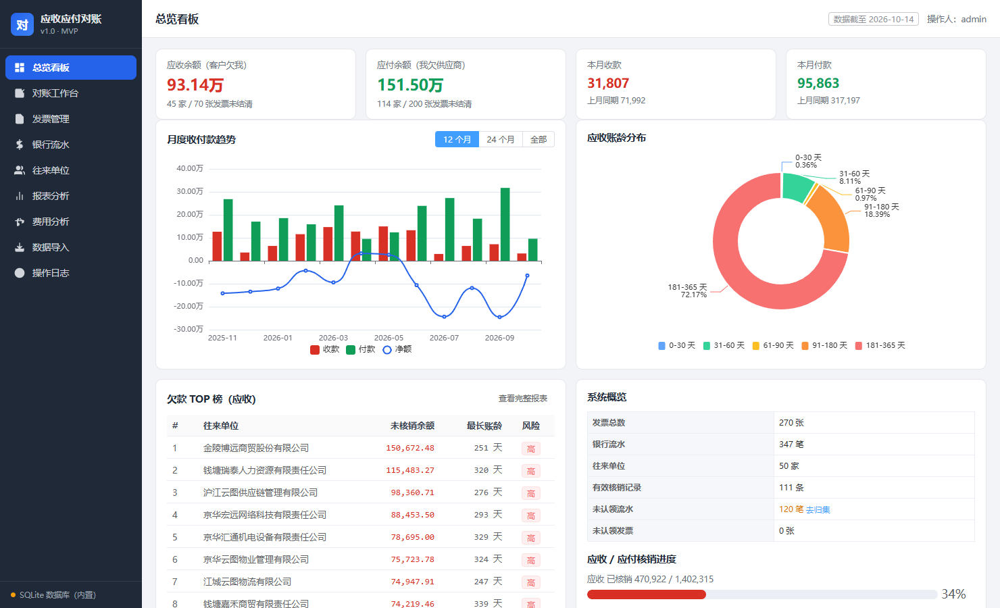
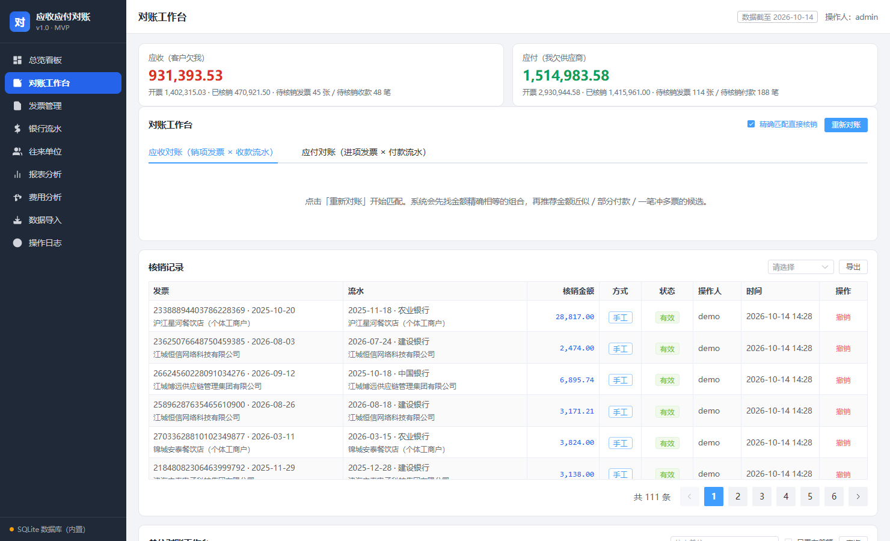
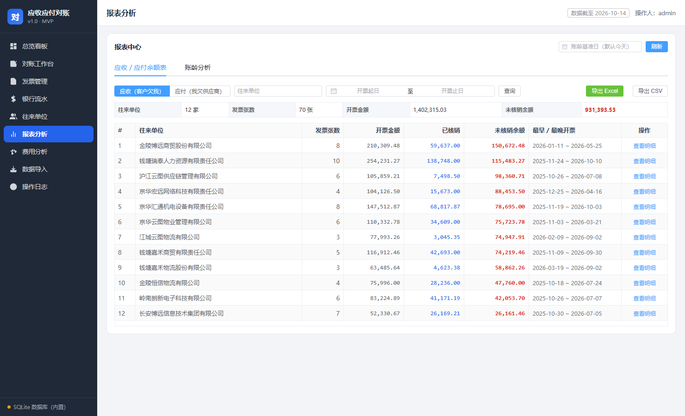
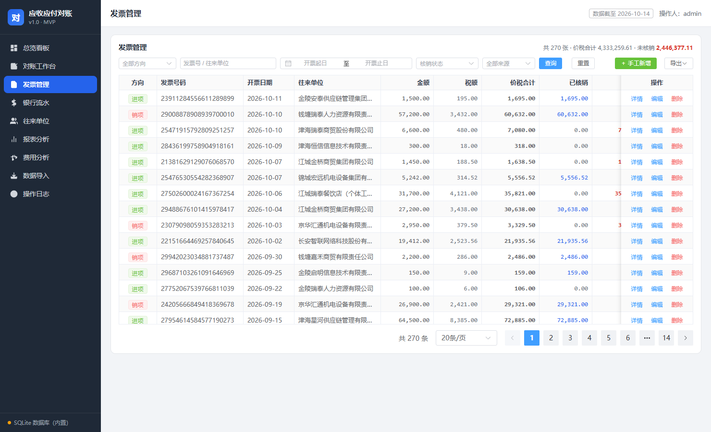

# FinRecon · 应收应付对账系统

一套开箱即用的中小企业**应收 / 应付对账**系统：把银行流水和发票导进去，自动核销、差异分诊、出报表。
后端 FastAPI + SQLAlchemy（SQLite / MySQL 双后端），前端 Vue 3 + Element Plus + ECharts（全部资源离线内置，断网可用）。

## 界面预览

> 以下截图均基于 `scripts/generate_demo_data.py` 生成的**合成演示数据**，不含任何真实主体。

| 总览看板 | 对账工作台 |
|---|---|
|  |  |

| 报表分析 | 发票管理 |
|---|---|
|  |  |

---

## 数据脱敏声明

> **本仓库不含任何真实业务数据。**

- 仓库里的代码已做敏感信息清理：不含真实企业名称、纳税人识别号、银行账号、人员姓名。
- 演示数据由 [`scripts/generate_demo_data.py`](scripts/generate_demo_data.py) 程序化生成，
  公司名、税号、账号、发票号、金额、日期**全部随机虚构**，与任何真实主体无关。
- `data/`（数据库）、`logs/`、`backup/`、`.env` 均已在 `.gitignore` 中排除。
  请在本地妥善保管自己的真实账套，**不要**把它们提交到本仓库。

---

## 快速开始

### 1. 安装依赖

```bash
python -m venv .venv
.venv\Scripts\activate          # Linux/macOS: source .venv/bin/activate
pip install -r requirements.txt -i https://mirrors.aliyun.com/pypi/simple/
```

要求 Python 3.10+。SQLite 版不需要任何外部数据库，装完依赖即可跑。

### 2. 生成演示数据（可选，但推荐先看效果）

```bash
python scripts/generate_demo_data.py
```

会写入 `data/app.db`：约 50 家往来单位、270 张发票、460+ 行明细、350 笔银行流水、110 条核销记录。
库里已有数据时会拒绝执行，加 `--force` 清空重建，加 `--seed 42` 换一份随机数据。

### 3. 启动

```bash
python run_server.py
# 等价命令：
python -m uvicorn app.main:app --host 0.0.0.0 --port 8000
```

浏览器打开 <http://localhost:8000>。

Windows 下也可以直接双击 `start.bat`（自动检查依赖 → 初始化数据库 → 起服务 → 开浏览器）。

---

## 功能

### 对账

| 能力 | 说明 |
|---|---|
| 自动核销 | 单位一致 **且** 金额分文不差才自动核销，宁可少销也不错销 |
| 差异池 | 单位一致但金额不等 → 不自动核销，进差异池分诊，给 5 种建议：`partial` 部分收款 / `over` 多收多付 / `near` 小额抹零 / `combo` 多票凑单 / `ignore` 挂起 |
| 单位对账工作台 | 按往来单位四栏并列（发票未核销 / 流水未核销 / 已核销 / 差额），支持下钻到单据 |
| 差额记账 | 人工确认时记录 `diff_amount` + 原因，差额随处理逐笔收敛，不污染现金流 |
| 撤销留痕 | 核销是 append-only 事件表，撤销 = 插入反向记录，历史永不丢失 |

### 费用分析

- 按 **23 类**自动归类进销项发票明细（餐饮、住宿、油费、工程服务等稳定命中）
- 三级判定：名称里的税收分类大类 → 税收分类编码前缀 → 名称 / 销方关键词
- 类别占比环形图 + 月度趋势堆叠柱 + TOP20 往来单位 + 下钻明细，支持导出 Excel

### 报表与导出

仪表盘、账龄分析、余额表、TOP 榜、趋势图，全部支持 Excel / CSV 导出。

### 数据导入

内置四个 Excel 解析适配器，自动识别列映射并给出预览：

| 来源 | 说明 |
|---|---|
| 农业银行 | 「账户历史明细」，跳过前 3 行元信息，自动提取账号 / 户名 |
| 中国银行 | 42 列按中文前缀匹配，按交易类型（来账 / 往账）取对手方 |
| 建设银行 | 37 列取 14 个有效列，借方发生额 = 支出、贷方发生额 = 收入 |
| 发票 | 多 sheet，一票多行明细，按「发票号码 + 销方识别号」聚合，明细行收纳进 items |

去重：银行流水按 `银行|账号|日期|时间|金额|方向|摘要|用途|对方户名|对方账号` 生成指纹，
配合同指纹序号区分同一秒内的重复手续费；发票按 `方向|发票号|销方税号|日期|价税合计`。唯一索引兜底，重复上传直接跳过并计数。

---

## 目录结构

```
FinRecon/
├── app/
│   ├── main.py              FastAPI 入口
│   ├── config.py            配置（环境变量 / .env）
│   ├── models.py            七张核心表的 ORM 模型
│   ├── database.py          SQLite / MySQL 双后端引擎
│   ├── routers/             API 路由
│   ├── parsers/             Excel 解析适配器
│   ├── engine/              对账引擎
│   ├── category.py          费用分类规则（23 类）
│   ├── export/              Excel / CSV 导出
│   └── static/              前端（Vue 3 + Element Plus + ECharts，离线可用）
├── scripts/
│   ├── generate_demo_data.py    生成合成演示数据
│   ├── stress_test.py           并发压测 + 接口回归
│   ├── recategorize.py          按最新规则重打全库费用类别
│   ├── migrate_to_mysql.py      SQLite → MySQL 全量迁移
│   ├── backfill_invoice_items.py 从 Excel 重新抽取发票明细
│   └── test_all.py / recon_test.py / smoke_ui.js
├── run_server.py            服务启动入口
├── start.bat                Windows 一键启动
├── FinReconServer.spec      PyInstaller 打包配置
├── .env.example             配置示例（复制为 .env 后修改）
├── 产品设计文档-应收应付对账系统MVP.md
├── 技术方案-应收应付对账系统MVP.md
└── 使用说明.md
```

---

## 配置

复制 `.env.example` 为 `.env` 后修改。最关键的两项：

```ini
# 本方主体名称关键词：用于判定销项/进项与流水方向
SELF_KEYWORDS=示例科技
# 本方纳税人识别号（精确识别，优先级高于关键词）
SELF_TAX_IDS=91110108MA0EXAMPLE
```

切换 MySQL 只需改一行：

```ini
DATABASE_URL=mysql+pymysql://root:密码@127.0.0.1:3306/ar_ap?charset=utf8mb4
```

库不存在时会自动创建（utf8mb4）。把已有 SQLite 数据搬过去：

```bash
python scripts/migrate_to_mysql.py --host 127.0.0.1 --user root --password 密码 \
    --database ar_ap --sqlite data/app.db --drop --write-env
```

---

## 运维

```bash
# 并发压测 + 接口回归（改连接池或加并发代码后必跑）
python scripts/stress_test.py --rounds 10 --workers 24

# 调整 app/category.py 分类规则后，必须重打全库类别（先预演再执行）
python scripts/recategorize.py --dry-run
python scripts/recategorize.py
```

打包成免安装 exe（Windows，PyInstaller）：

```bash
python -m PyInstaller FinReconServer.spec --noconfirm --clean
copy dist\FinReconServer.exe .\FinReconServer.exe
```

> exe 必须与 `data` 文件夹同级，程序按 exe 所在目录定位数据库。

---

## 已知设计决策

- **金额一律 `Decimal`**：后端 `DECIMAL(16,2)`，禁止浮点参与金额运算。
- **SQLite 必须用 `QueuePool`**：早期用 `StaticPool` 会让一条物理连接被多线程复用，
  导致 cursor 串扰（`IndexError: tuple index out of range`）；改用 `SingletonThreadPool`
  更糟（线程 ident 复用 + 连接被关闭 → `Cannot operate on a closed database`，最终**段错误**）。
  现方案为 `QueuePool` + WAL + `busy_timeout`。
- **启动脚本必须等端口真正 LISTENING 再开浏览器**，否则页面报 Network Error。
- **Windows 下 `.bat` 必须是 GBK(ANSI) + CRLF**，UTF-8 + LF 会让 cmd 解析错乱（双击一闪而过）。

---

## 许可

MIT License。详见 [LICENSE](LICENSE)。
